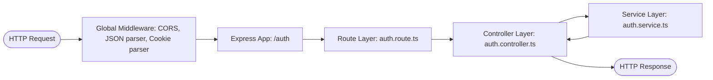

# 🚀 Backend Developer Starter Project (Rise Interns)

Welcome to the **Backend Developer Starter Project**! This project serves as a foundational boilerplate and learning template for backend engineering interns. It is built using modern **Node.js**, **Express 5**, **TypeScript**, and **pnpm**, structured using a clean, scalable **Modular (Layered) Architecture**.

---

## 📋 Table of Contents

- [Overview](#-overview)
- [Tech Stack](#-tech-stack)
- [Project Architecture & Directory Structure](#-project-architecture--directory-structure)
- [Prerequisites](#-prerequisites)
- [Project Initialization & Setup](#-project-initialization--setup)
- [Available Scripts](#-available-scripts)
- [API Endpoints Reference](#-api-endpoints-reference)
- [Interns' Quick Guide & Concepts](#-interns-quick-guide--concepts)
  - [The Request Lifecycle](#the-request-lifecycle)
  - [How to Add a New Module (Step-by-Step)](#how-to-add-a-new-module-step-by-step)
  - [Key Rules & Best Practices](#key-rules--best-practices)
- [Upcoming Exercises & Milestones](#-upcoming-exercises--milestones)

---

## 🎯 Overview

The purpose of this template is to give interns a production-ready mental model of how backend applications are organized:
- **Separation of Concerns**: Business logic is decoupled from HTTP transport.
- **Modular Design**: Features are encapsulated in self-contained module directories.
- **Type Safety**: Strictly typed with modern TypeScript (`nodenext` ESM).
- **Process Resilience**: Includes graceful shutdown hooks (`SIGINT`, `SIGTERM`) and global process error monitors (`unhandledRejection`, `uncaughtException`).

---

## 🛠 Tech Stack

| Technology | Purpose |
| :--- | :--- |
| **Node.js** | JavaScript runtime environment |
| **Express 5** | Minimal and fast web application framework |
| **TypeScript** | Type-safe JavaScript superset with strict type checking |
| **tsx** | High-performance TypeScript execution engine & hot-reloading dev runner |
| **pnpm** | Fast, disk space efficient package manager |
| **dotenv** | Environment variable management |
| **cors** | Cross-Origin Resource Sharing middleware |
| **cookie-parser** | HTTP cookie parsing middleware |

---

## 📂 Project Architecture & Directory Structure

```text
project-setup/
├── .env.example              # Template for environment variables
├── .env                      # Local environment configuration (do not commit!)
├── .gitignore                # Git ignore rules for node_modules, dist, .env
├── package.json              # Project dependencies, engines, and scripts
├── pnpm-lock.yaml            # pnpm lockfile
├── pnpm-workspace.yaml       # Workspace configuration
├── tsconfig.json             # TypeScript compiler settings (ESM NodeNext)
└── src/
    ├── server.ts             # Application entrypoint: server bootstrap & graceful shutdown
    ├── app.ts                # Express app setup: global middlewares & root routes
    ├── config/
    │   └── env.config.ts     # Centralized & typed environment variables
    └── modules/
        └── auth/             # Example Feature Module: Authentication
            ├── auth.types.ts       # TypeScript interfaces and DTO definitions
            ├── auth.route.ts       # Route endpoints mapped to controllers
            ├── auth.controller.ts  # Request/response orchestration and status codes
            └── auth.service.ts     # Core business logic and data processing
```

### Architectural Flow:
1. **`server.ts`**: Starts the HTTP server, listens on the configured port, and manages shutdown signals and uncaught exceptions.
2. **`app.ts`**: Configures global middleware (`cors`, `express.json()`, `cookieParser()`, `urlencoded()`), attaches route routers, and handles 404 fallbacks.
3. **`config/`**: Loads `.env` via `dotenv` and exposes strongly-typed configuration settings.
4. **`modules/`**: Each domain feature contains 4 distinct layers:
   - **`types`**: Interfaces for request payloads, responses, and models.
   - **`route`**: Maps HTTP verbs and paths (`GET`, `POST`, etc.) to controller methods.
   - **`controller`**: Extracts incoming data (`req.body`, `req.params`, `req.query`), delegates to services, and returns standardized responses.
   - **`service`**: Implements the actual domain logic, database operations, and business rules.

---

## ⚙️ Prerequisites

Ensure you have the following installed on your machine:
- **Node.js** (v20.x or higher recommended)
- **pnpm** (v9+ or v12+)

To check your versions:
```bash
node -v
pnpm -v
```

> **Tip:** If you don't have `pnpm` installed, you can enable it via corepack:
> ```bash
> corepack enable
> corepack prepare pnpm@latest --activate
> ```

---

## 🚀 Project Initialization & Setup

Follow these exact steps to clone, configure, and launch the project:

### 1. Clone the Repository
```bash
git clone https://github.com/ShahriarRefat0/rise_inter_class.git
cd rise_inter_class
```

### 2. Install Dependencies
```bash
pnpm install
```

### 3. Setup Environment Variables
Create your local `.env` configuration file from the template:
```bash
cp .env.example .env
```
Ensure `.env` contains:
```env
PORT=5000
NODE_ENVIRONMENT=development
```

### 4. Start the Development Server
```bash
pnpm run dev
```
The server will boot with watch mode active on [http://localhost:5000](http://localhost:5000).

---

## 📜 Available Scripts

| Script | Command | Description |
| :--- | :--- | :--- |
| **`pnpm run dev`** | `tsx --watch src/server.ts` | Runs the server in development mode with live reload |
| **`pnpm run build`** | `tsc` | Compiles TypeScript into production JavaScript in `dist/` |
| **`pnpm start`** | `node dist/server.js` | Runs the compiled production code |
| **`pnpm test`** | `echo ...` | Runs automated tests (to be implemented) |

---

## 📡 API Endpoints Reference

### 1. Server Health Check
- **Method:** `GET`
- **URL:** `/`
- **Response:** `200 OK`
```json
{
  "success": true,
  "message": "Server is running on port 5000"
}
```

### 2. User Login
- **Method:** `POST`
- **URL:** `/auth/login`
- **Headers:** `Content-Type: application/json`
- **Body:**
```json
{
  "email": "refat@gmail.com",
  "password": "1234"
}
```
- **Response:** `200 OK`
```json
{
  "seccess": true,
  "message": "Login success full",
  "data": {
    "name": "refat",
    "email": "refat@gmail.com",
    "password": "1234"
  }
}
```

### 3. Route Not Found (404 Fallback)
- **Method:** `ANY`
- **URL:** `/any-undefined-route`
- **Response:** `404 Not Found`
```json
{
  "success": false,
  "message": "Route Not Found",
  "error": {
    "path": "/any-undefined-route",
    "message": "Your requested path was not found."
  }
}
```

---

## 🎓 Interns' Quick Guide & Concepts

### The Request Lifecycle
Whenever an API client (Postman, browser, mobile app) calls an endpoint, the request flows through this sequence:



1. **Client** sends request with payload.
2. **`app.ts`** parses headers, JSON body, and cookies.
3. **`auth.route.ts`** matches `/auth/login` and triggers `authController.login`.
4. **`auth.controller.ts`** extracts `{ email, password }` from `req.body` and passes it to `authService.login()`.
5. **`auth.service.ts`** validates user credentials against data and returns user object.
6. **`auth.controller.ts`** formats standard response `{ success, message, data }` and returns it to the client.

---

### How to Add a New Module (Step-by-Step)

When implementing a new feature (for example: **Products**):

1. **Create the module folder**:
   ```bash
   mkdir -p src/modules/product
   ```

2. **Define Types (`src/modules/product/product.types.ts`)**:
   ```typescript
   export interface IProduct {
     id?: string;
     title: string;
     price: number;
   }
   ```

3. **Create the Service (`src/modules/product/product.service.ts`)**:
   ```typescript
   import { IProduct } from "./product.types.js";

   const createProduct = async (payload: IProduct) => {
     // Save to database
     return payload;
   };

   export const productService = {
     createProduct,
   };
   ```

4. **Create the Controller (`src/modules/product/product.controller.ts`)**:
   ```typescript
   import { Request, Response } from "express";
   import { productService } from "./product.service.js";

   const createProduct = async (req: Request, res: Response) => {
     const result = await productService.createProduct(req.body);
     res.status(201).json({
       success: true,
       message: "Product created successfully",
       data: result,
     });
   };

   export const productController = {
     createProduct,
   };
   ```

5. **Create the Router (`src/modules/product/product.route.ts`)**:
   ```typescript
   import { Router } from "express";
   import { productController } from "./product.controller.js";

   const router = Router();
   router.post("/", productController.createProduct);

   export const productRouter = router;
   ```

6. **Register Router in `src/app.ts`**:
   ```typescript
   import { productRouter } from "./modules/product/product.route.js";

   app.use("/products", productRouter);
   ```

---

### Key Rules & Best Practices

1. **ESM Import Syntax**:
   Because `tsconfig.json` uses `"module": "nodenext"`, all relative TypeScript imports must specify the `.js` extension:
   ```typescript
   // Correct:
   import { authRouter } from "./modules/auth/auth.route.js";

   // Incorrect (will fail compiler in NodeNext):
   import { authRouter } from "./modules/auth/auth.route";
   ```

2. **Never Put Business Logic in Controllers**:
   Controllers only manage HTTP request extraction and response formatting. All verification, calculations, and DB access belong in the Service layer.

3. **Git Hygiene**:
   - Never commit `node_modules/` or `.env` to Git.
   - Always keep your `.gitignore` up to date.
   - Push sensible commit messages (e.g. `feat: add user registration module`).

---

## 🎯 Upcoming Exercises & Milestones

As part of your internship training, you will work on the following tasks:

- [ ] **Global Error Handler**: Add an Express error handling middleware `(err, req, res, next)` to capture errors and return consistent JSON error formats.
- [ ] **Validation Layer**: Integrate `zod` schema validation to validate request bodies before reaching the controller.
- [ ] **Database Integration**: Connect MongoDB (Mongoose) or PostgreSQL (Prisma).
- [ ] **Auth Expansion**: Implement Registration, Password Hashing (`bcrypt`), and JWT Access Tokens (`jsonwebtoken`).
- [ ] **Code Polish**: Refactor typo names (`authRouther` -> `authRouter`, `authSevice` -> `authService`, `seccess` -> `success`).

